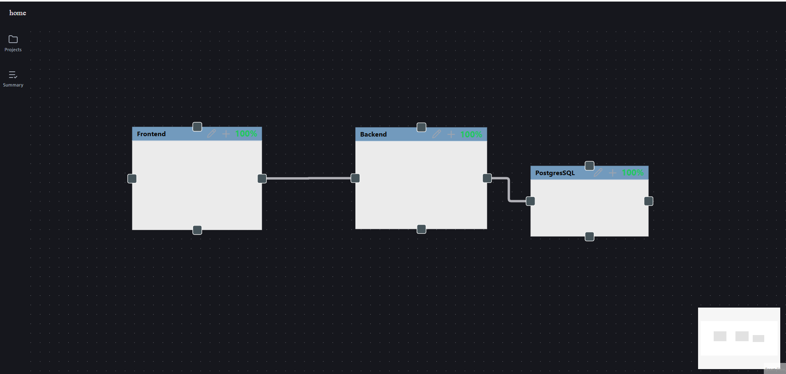

## Overview
A full-stack, self-hosted web application designed to visually map project architecture, ideas, and node structures directly into actionable tasks using an interactive canvas interface.

## Architecture



* **Frontend:** React + Vite application utilizing `@xyflow/react` and MobX-state-tree for canvas state management, served via Nginx in production.
* **Backend:** FastAPI REST service handling node orchestration, data hydration, and API endpoints.
* **Database & Migrations:** PostgreSQL 16 managed via Alembic for automated database migrations.

## Getting Started

You can run the project either using Docker Compose (recommended for production/testing) or locally for development.

### Option 1: Docker Compose (Automated Production / Production Testing)

The container setup automatically manages database migrations via an `entrypoint.sh` script during container startup (`alembic upgrade head`).

1. **Configure Environment:**
   Ensure your `.env` and `apps.env` files contain your PostgreSQL credentials and registry configurations.
    Ensure your production directory contains an `apps.env` file with your database credentials:
    ```env
    POSTGRES_USER=<user>
    POSTGRES_PASSWORD=<password>
    POSTGRES_DB=planner-prod-db
    POSTGRES_HOST=planning-db
    ```

2. **Build and Start Containers:**
   ```bash
   docker compose up --build -d
   ```

### Option 2: Local Development Workflow

Use this workflow on your development machine for rapid iteration and code changes.

1. **Start the Database:**
Spin up just the database using Docker Compose:
```bash
docker compose up db -d

```


2. **Run the Backend Locally:**
Execute Uvicorn with auto-reload pointing to your local database configuration:
```bash
uvicorn main:app --host 0.0.0.0 --port 5001 --reload

```


3. **Run the Frontend Locally:**
Start the Vite development server:
```bash
npm run dev

```

## [Latest Release](docs/latest.md)


## [Roadmap](docs/roadmap.md)