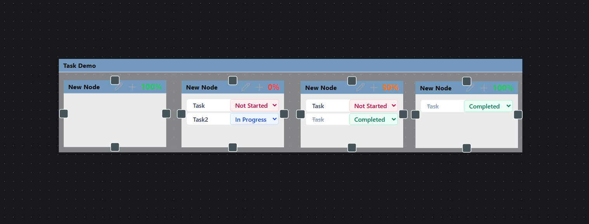
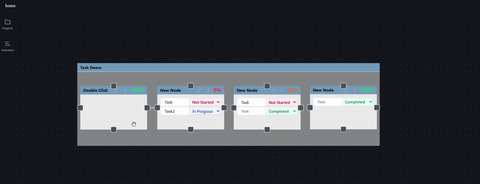

# V1 Feature Guide & Capabilities

This document details the core user features, canvas capabilities, and node interactions available in the V1 release of the Project Planner.

---

## 1. Core Canvas Capabilities

* **Interactive Infinite Canvas:** Pan, zoom, and navigate project spaces using `@xyflow/react` (React Flow) with persistent zoom levels and canvas positions.
* **Node Drag & Drop:** Move nodes freely across the workspace with real-time coordinate syncing back to the database.
* **Node Grouping & Parent-Child Relationships:** Drag nodes inside parent group containers to organize complex project sections or subsystem clusters visually.
* **Dynamic Edge Connections:** Connect any node to another by dragging target handles to draw relationships, dependencies, or data flows.

---

## 2. Node Types & Specific Behaviors

### NoteNode
Designed for fast ideation, detailed documentation, and context-building directly on the canvas.

* **Inline Text Editing:** Click directly into the note card to update title (`label`) and body content (`description`).
* **Isolated Mouse Wheel Capture:** Captures mouse wheel scrolling (`nowheel` event stop) so scrolling long notes won't accidentally zoom or pan the main canvas.
* **Auto-Syncing:** Text edits auto-sync on blur or change events directly to the client state store (`NodeStore`).

### TaskNode
Built to track actionable work items, system modules, and project sub-tasks.

* **Task Tracking:** Attach discrete sub-tasks directly inside component cards.
* **Progress Indicators:** Visual indicators showing task completion states.

* **Hierarchical Nesting:** Can be embedded within larger parent grouping nodes to represent subsystems or epics.

---

## 3. Node Interactions & Canvas Controls

| Action | Control / Gesture | Outcome |
| :--- | :--- | :--- |
| **Create Node** | Canvas Context Menu / Toolbar | Spawns a new `NoteNode` or `ComponentNode` at cursor position |
| **Connect Nodes** | Drag from handle dot `(•)` to target `(•)` | Creates a persistent directed edge/relationship line |
| **Edit Content** | Single Click inside text area | Focuses field for live editing |
| **Scroll Long Note** | Mouse Wheel inside `NoteNode` | Scrolls internal note body without shifting canvas zoom |
| **Group Nodes** | Drag node into parent frame | Binds node position relative to parent container |
| **Delete Element** | Select element + `Backspace` / `Delete` | Removes target node/edge and updates relational links |